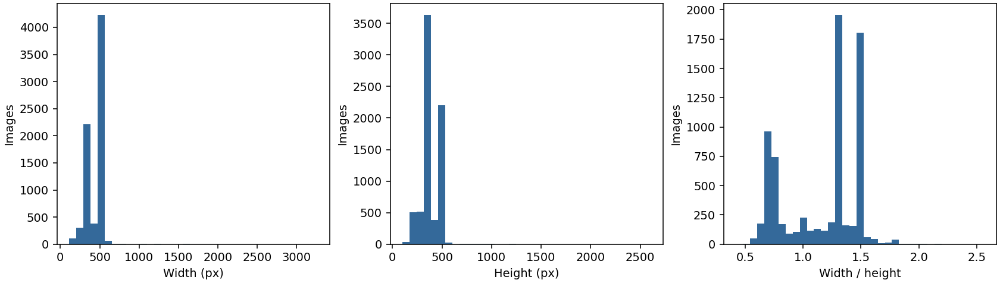
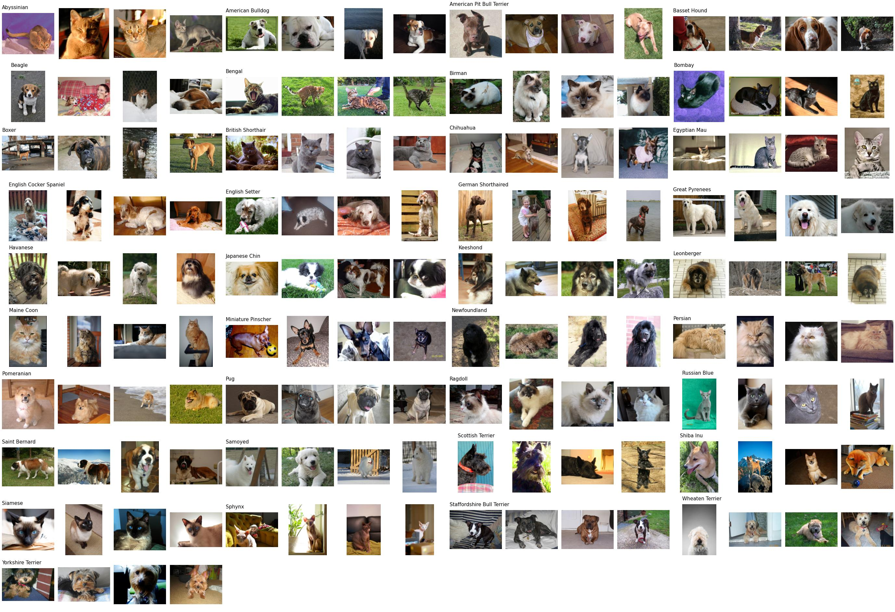
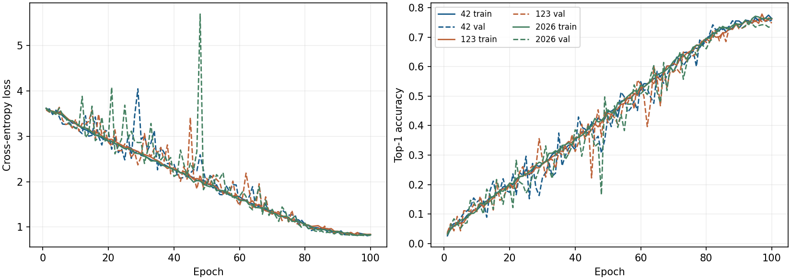
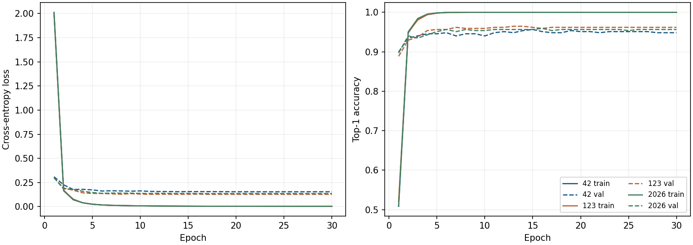
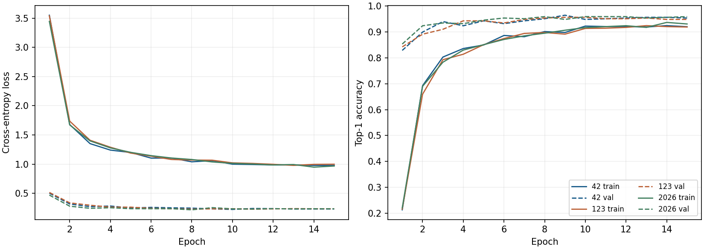
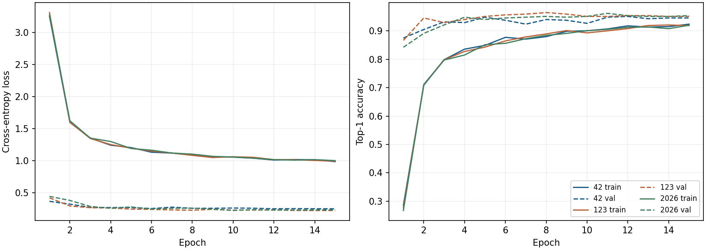
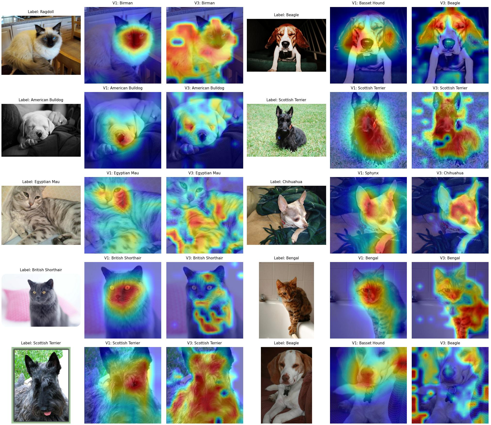
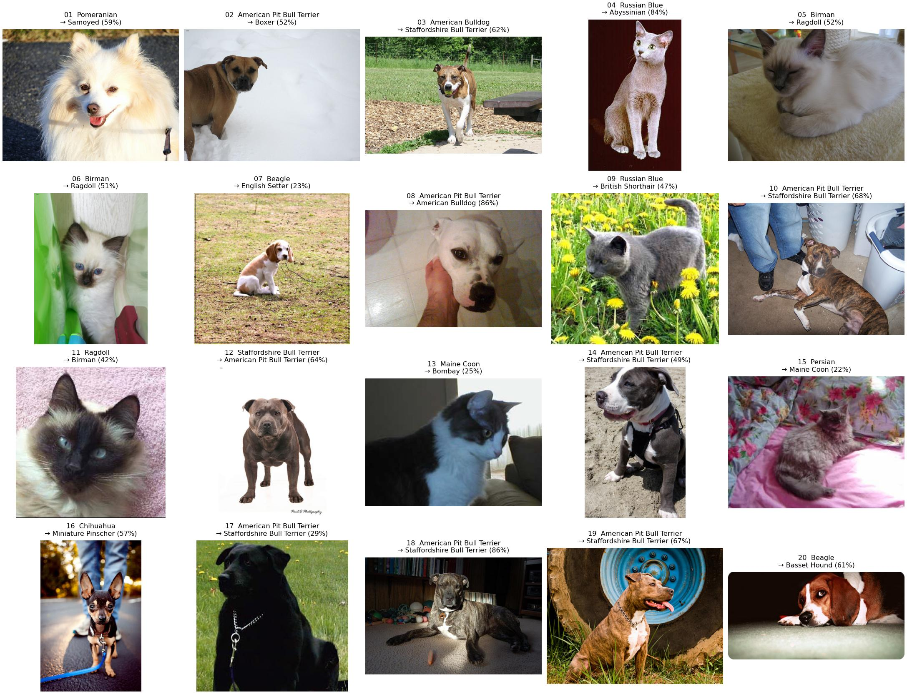
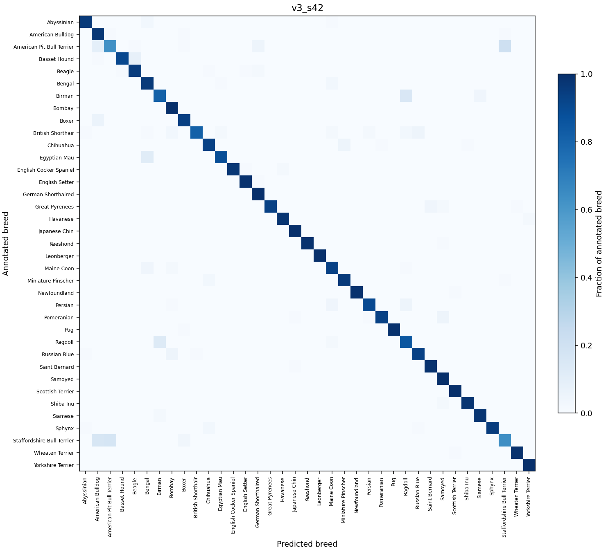

# Oxford-IIIT Pet 视觉模型微调实验报告

## 1 数据与划分

Oxford-IIIT Pet 含 37 个品种，其中猫 12 类、狗 25 类。用固定种子 42 从官方 trainval 分层抽取 10% 作为验证集，训练、验证和测试分别为 3,312、368 和 3,669 张。品种标签及猫狗大类映射来自官方标注。[Oxford-IIIT Pet 数据集](https://www.robots.ox.ac.uk/~vgg/data/pets/)

原图中位尺寸为 500 × 375 像素（宽、高分别取中位数），宽高比的第 5 至 95 百分位为 0.67 至 1.51。解码排查共排除 0 张图。有效图像原始模式为 RGB 7,346 张、RGBA 3 张，读取时统一转为 RGB。每类样本数、分位数和排除记录见下表及数据统计。[数据统计 JSON](outputs/data/summary.json)

观察训练样例时，优先检查短毛灰色猫品种（British Shorthair、Russian Blue）、重点色或长毛猫品种（Birman、Ragdoll），以及 Staffordshire Bull Terrier 与 American Pit Bull Terrier。实测错分配对见第 5 节。

37 类样本数

| 品种 | 大类 | 训练 | 验证 | 测试 |
| --- | --- | ---: | ---: | ---: |
| Abyssinian | 猫 | 90 | 10 | 98 |
| American Bulldog | 狗 | 90 | 10 | 100 |
| American Pit Bull Terrier | 狗 | 90 | 10 | 100 |
| Basset Hound | 狗 | 90 | 10 | 100 |
| Beagle | 狗 | 90 | 10 | 100 |
| Bengal | 猫 | 90 | 10 | 100 |
| Birman | 猫 | 90 | 10 | 100 |
| Bombay | 猫 | 87 | 9 | 88 |
| Boxer | 狗 | 90 | 10 | 99 |
| British Shorthair | 猫 | 90 | 10 | 100 |
| Chihuahua | 狗 | 90 | 10 | 100 |
| Egyptian Mau | 猫 | 84 | 9 | 97 |
| English Cocker Spaniel | 狗 | 86 | 10 | 100 |
| English Setter | 狗 | 90 | 10 | 100 |
| German Shorthaired | 狗 | 90 | 10 | 100 |
| Great Pyrenees | 狗 | 90 | 10 | 100 |
| Havanese | 狗 | 90 | 10 | 100 |
| Japanese Chin | 狗 | 90 | 10 | 100 |
| Keeshond | 狗 | 90 | 10 | 99 |
| Leonberger | 狗 | 90 | 10 | 100 |
| Maine Coon | 猫 | 90 | 10 | 100 |
| Miniature Pinscher | 狗 | 90 | 10 | 100 |
| Newfoundland | 狗 | 86 | 10 | 100 |
| Persian | 猫 | 90 | 10 | 100 |
| Pomeranian | 狗 | 90 | 10 | 100 |
| Pug | 狗 | 90 | 10 | 100 |
| Ragdoll | 猫 | 90 | 10 | 100 |
| Russian Blue | 猫 | 90 | 10 | 100 |
| Saint Bernard | 狗 | 90 | 10 | 100 |
| Samoyed | 狗 | 90 | 10 | 100 |
| Scottish Terrier | 狗 | 90 | 10 | 99 |
| Shiba Inu | 狗 | 90 | 10 | 100 |
| Siamese | 猫 | 89 | 10 | 100 |
| Sphynx | 猫 | 90 | 10 | 100 |
| Staffordshire Bull Terrier | 狗 | 90 | 10 | 89 |
| Wheaten Terrier | 狗 | 90 | 10 | 100 |
| Yorkshire Terrier | 狗 | 90 | 10 | 100 |

## 2 训练设置

在 NVIDIA GeForce RTX 5060 Ti 上运行。PyTorch 2.11.0+cu128，CUDA 12.8，AMP 使用 bfloat16。主实验随机种子为 42、123、2026。每次运行按验证集 top-1 选 checkpoint，同分取较早轮次。

V2 至 V4 使用相同的 ViT-B/16 权重，权重在 ImageNet-21k 上预训练后又在 ImageNet-1k 上微调。输入尺寸、均值和标准差由 timm 的 `resolve_data_config` 读取。验证和测试均缩放短边至 248、中心裁剪至 224，图像训练使用 224 随机缩放裁剪、水平翻转和 RandAugment。V2 缓存特征时使用固定中心裁剪。[timm 权重说明](https://huggingface.co/timm/vit_base_patch16_224.augreg_in21k_ft_in1k)

| 实验 | 轮数 | 单步批量 × 累积步数 | 优化器 | 学习率 |
| --- | ---: | ---: | --- | --- |
| V1 | 100 | 64 × 1 | sgd | 0.05 |
| V2 | 30 | 64 × 1 | adamw | 0.001 |
| V3 | 15 | 16 × 4 | adamw | 主干 3e-05，分类头 0.0003 |
| V4 | 15 | 32 × 2 | adamw | 0.001 |

V1 使用动量 0.9、权重衰减 0.0005，预热 5 轮。V2 至 V4 使用权重衰减 0.05，预热 1 轮。各组预热后使用余弦衰减。V3 和 V4 使用 0.1 标签平滑、0.1 drop path 和梯度检查点。V4 在每个注意力块的 qkv 线性层注入 LoRA，将 alpha 设置为秩的两倍，LoRA dropout 为 0.1，分类头同时参与训练。

## 3 主实验结果

测试集指标为三个种子的均值 ± 样本标准差。峰值显存取三个种子训练阶段的 `torch.cuda.max_memory_allocated` 最大值，单位 GiB。单轮耗时为每个种子训练轮耗时中位数的中位数，含数据读取和训练，验证、存盘另计。

| 模型 | 可训练参数量 | 峰值显存（GiB） | 单 epoch（s） | 测试 top-1（%） | 测试 top-5（%） | 测试 Macro-F1（%） | 猫狗误判率（%） |
| --- | ---: | ---: | ---: | ---: | ---: | ---: | ---: |
| V1 ResNet-18 从零 | 11,195,493 | 0.912 | 2.69 | 67.67 ± 0.89 | 92.51 ± 0.15 | 67.21 ± 0.97 | 4.82 ± 0.21 |
| V2 ViT-B/16 线性探测 | 28,453 | 0.018 | 0.05 | 94.09 ± 0.24 | 99.72 ± 0.07 | 94.00 ± 0.24 | 0.05 ± 0.03 |
| V3 ViT-B/16 全量微调 | 85,827,109 | 1.645 | 17.58 | 93.87 ± 0.53 | 99.80 ± 0.02 | 93.75 ± 0.55 | 0.15 ± 0.06 |
| V4 ViT-B/16 + LoRA (r=8) | 323,365 | 0.769 | 15.46 | 94.21 ± 0.10 | 99.78 ± 0.05 | 94.12 ± 0.10 | 0.09 ± 0.02 |

V2 表中列的是分类头拟合开销。训练和验证特征一次性抽取耗时 35.4 s，前向抽取峰值为 0.509 GiB，CLS 和均值特征共享同一次骨干前向。

| 实验 | 中位吞吐量（图/s） | 取下一批的主机等待占比（%） |
| --- | ---: | ---: |
| V1 | 1229.6 | 61.9 |
| V2 | 72593.1 | 11.0 |
| V3 | 188.4 | 0.5 |
| V4 | 214.2 | 0.8 |

DataLoader 使用 6 个 worker 和页锁定内存。等待占比排除每次运行的首轮启动开销，表示主机获取 batch 时阻塞的时间占单轮耗时的比例。GPU 异步计算可与这段时间重叠。

本机每 5 秒采样一次整卡利用率。主实验中位数分别为 V1 64%（208 次）、V3 98%（166 次）、V4 99%（174 次）。采样覆盖训练、验证和存盘间隙。[GPU 采样记录](outputs/analysis/gpu_utilization.csv)

V3 和 V4 的主机取批等待占比低，整卡利用率较高。V1 的训练轮短，取批等待占比明显较高。整卡采样也包含验证和存盘间隙，定位 V1 的 GPU 空闲来源还需要逐批记录数据加载与 GPU 内核时间。

### 训练与验证曲线

V1 最后一轮训练 top-1 与验证 top-1 的平均差为 +1.51 个百分点。验证集最佳 top-1 平均为 75.82%，最后一轮验证 top-1 平均为 74.73%，差值为 1.09 个百分点。验证损失从各次运行最低值的平均 0.824 到末轮平均 0.827。末轮训练准确率略高于验证集。结合验证损失接近最低值，训练末期的过拟合迹象较轻。训练准确率在实时增强后的图片上计算。

V3 和 V4 的训练损失使用标签平滑，验证损失使用普通交叉熵。

## 4 消融实验

消融固定种子 42，使用验证集最佳 checkpoint 对比。增强消融沿用 V3 的其余训练设置，秩值消融沿用 V4 设置并固定 alpha/r = 2。主表预先固定 V2 使用 CLS、V3 使用 RandAugment、V4 使用 r=8。

### 线性探测的特征池化

| 设置 | 最高验证 top-1 | 最佳轮次 | 可训练参数量 | 训练峰值显存（GiB） |
| --- | ---: | ---: | ---: | ---: |
| CLS | 95.65% | 15 | 28,453 | 0.018 |
| Patch token 均值 | 94.84% | 13 | 28,453 | 0.018 |

种子 42 下，CLS 的最佳验证 top-1 比次高设置高 0.82 个百分点。

### 全量微调的数据增强

| 设置 | 最高验证 top-1 | 最佳轮次 | 可训练参数量 | 训练峰值显存（GiB） |
| --- | ---: | ---: | ---: | ---: |
| 无增强 | 95.65% | 5 | 85,827,109 | 1.645 |
| 裁剪与翻转 | 96.20% | 8 | 85,827,109 | 1.645 |
| 裁剪、翻转与 RandAugment | 96.47% | 9 | 85,827,109 | 1.645 |

种子 42 下，裁剪、翻转与 RandAugment 的最佳验证 top-1 比次高设置高 0.27 个百分点。

### LoRA 秩值

| 设置 | 最高验证 top-1 | 最佳轮次 | 可训练参数量 | 训练峰值显存（GiB） |
| --- | ---: | ---: | ---: | ---: |
| r=4 | 95.65% | 5 | 175,909 | 0.767 |
| r=8 | 95.11% | 12 | 323,365 | 0.769 |
| r=16 | 95.11% | 11 | 618,277 | 0.774 |

种子 42 下，r=4 的最佳验证 top-1 比次高设置高 0.54 个百分点。

## 5 可视化与错误分析

使用种子 42 的 V1 和 V3，对测试集固定抽取的相同 10 张图片做 Grad-CAM。V1 取最后一个残差块，V3 取最后一个注意力块的第一层归一化输出，ViT 热图由 14 × 14 的 patch 网格上采样。每张热图的目标是对应模型的 top-1。[图片清单](outputs/analysis/grad_cam_samples.json)

从 V3 种子 42 的错分结果中固定随机抽取 20 张。图中标注真实标签、模型预测和 top-1 置信度。逐类准确率、带方向的猫狗误判数及混淆矩阵均保存在每次运行的指标文件中。[错分样本清单](outputs/analysis/error_samples.csv) · [V3 种子 42 逐类指标](outputs/evaluation/v3_s42/metrics.json)

按主要可见问题归类，构图与遮挡 7 张、外观相似 9 张、光照与画质 4 张。其中 19 张的标注品种仍位于模型的 top-5。

| 编号 | 标注 → 预测 | 主要类型 | 图像观察 |
| --- | --- | --- | --- |
| 1 | Pomeranian → Samoyed | 构图与遮挡 | 画面以浅色蓬松头胸为主。近景裁去身体与腿部，难以判断体型。 |
| 2 | American Pit Bull Terrier → Boxer | 构图与遮挡 | 狗站在雪中且靠左，身体部分出框。暗色短口鼻和垂耳是清楚可见的特征。 |
| 3 | American Bulldog → Staffordshire Bull Terrier | 外观相似 | 正向走来的狗呈宽头、虎斑和白胸，面部和被毛与预测品种相近。 |
| 4 | Russian Blue → Abyssinian | 光照与画质 | 深色背景上的毛发表现为浅灰偏暖，耳部突出，灰蓝被毛线索较弱。 |
| 5 | Birman → Ragdoll | 外观相似 | 浅色长毛、深色耳尖和面罩与 Ragdoll 相似。闭眼和伏卧减少了眼色与头部轮廓信息。 |
| 6 | Birman → Ragdoll | 构图与遮挡 | 猫夹在绿白色物体之间，下半身被遮挡。蓝眼和深色重点纹仍可见，两类都具有这些特征。 |
| 7 | Beagle → English Setter | 构图与遮挡 | 草地占画面大部分，幼犬离镜头较远。脸部细节有限，棕白斑与下垂耳较显眼。 |
| 8 | American Pit Bull Terrier → American Bulldog | 构图与遮挡 | 俯拍近景主要显示白色头部。人的手托在头侧，躯干和四肢比例难以辨认。 |
| 9 | Russian Blue → British Shorthair | 外观相似 | 灰色短毛和侧视中偏圆的脸与 British Shorthair 相近，眼睛细节弱。 |
| 10 | American Pit Bull Terrier → Staffordshire Bull Terrier | 外观相似 | 虎斑、白胸和短而宽的头部与 Staffordshire Bull Terrier 相近。室内俯视改变了躯干比例。 |
| 11 | Ragdoll → Birman | 构图与遮挡 | 近景只保留深面罩、蓝眼和浅色颈毛，这几处线索也见于 Birman。 |
| 12 | Staffordshire Bull Terrier → American Pit Bull Terrier | 外观相似 | 白底全身照可见宽头、折耳和粗壮前躯，与 American Pit Bull Terrier 的轮廓相近。 |
| 13 | Maine Coon → Bombay | 光照与画质 | 逆光使背部变暗，侧面黑白块清楚，毛发长度和脸部轮廓较难看清。 |
| 14 | American Pit Bull Terrier → Staffordshire Bull Terrier | 外观相似 | 头部轮廓、灰白配色和肌肉发达的前躯近似预测品种，胸背带盖住部分胸口。 |
| 15 | Persian → Maine Coon | 光照与画质 | 图像偏洋红且细节模糊。身体长毛可见，口鼻轮廓不清，标注品种跌出 top-5。 |
| 16 | Chihuahua → Miniature Pinscher | 外观相似 | 直立大耳、黑褐相间的短毛和较细的四肢与 Miniature Pinscher 相近。 |
| 17 | American Pit Bull Terrier → Staffordshire Bull Terrier | 光照与画质 | 黑色毛发接近阴影亮度，眼周、嘴部和耳廓细节弱。 |
| 18 | American Pit Bull Terrier → Staffordshire Bull Terrier | 外观相似 | 卧姿中可见虎斑、白胸和宽头。两类共有这些线索，暗背景也压低了躯干轮廓的对比。 |
| 19 | American Pit Bull Terrier → Staffordshire Bull Terrier | 外观相似 | 侧面显示短毛、宽口鼻和白胸，外观接近 Staffordshire Bull Terrier。 |
| 20 | Beagle → Basset Hound | 构图与遮挡 | 趴卧近景突出了长垂耳与棕白面部，腿长和身体比例基本不可见。 |

Grad-CAM 中，`beagle_61.jpg` 的 V1 响应集中在一侧脸颊和鼻口，判为 Basset Hound。V3 的较强响应分布在双眼、额部和耳根附近，判为 Beagle。`chihuahua_25.jpg` 的 V1 响应同时覆盖头部和前腿，判为 Sphynx。V3 响应偏向头部与耳尖，判为 Chihuahua。

在两组均判对的 `Egyptian_Mau_43.jpg` 上，V1 的较强响应主要在眼周和面部，V3 在躯干和前腿花纹上也有明显响应。`Ragdoll_35.jpg` 中 V1 主要响应深色面罩，V3 还响应背部和颈胸，但两者都判为 Birman。`beagle_28.jpg` 的 V3 热图在背景也有高响应。热图显示这 10 张输入上与预测类别相关的空间响应。

### V3 高频混淆配对（种子 42）

| 品种 A | 品种 B | A→B | B→A |
| --- | --- | ---: | ---: |
| American Pit Bull Terrier | Staffordshire Bull Terrier | 21 | 15 |
| Birman | Ragdoll | 15 | 13 |
| American Bulldog | Staffordshire Bull Terrier | 1 | 14 |
| Bengal | Egyptian Mau | 1 | 11 |
| American Bulldog | American Pit Bull Terrier | 1 | 9 |

## 6 实验结论与推理

1. V3 的测试 top-1 相对 V1 变化 **+26.20 个百分点**。这个差值反映从随机初始化的 ResNet-18 切换到预训练 ViT-B/16 全量微调后的综合收益。两组同时改变了骨干、初始化和优化配置，单独估计预训练收益需要增加同架构的随机初始化对照。
2. 线性探测的测试 top-1 比全量微调高 **0.22 个百分点**。本次设置下，冻结主干更节省训练算力。V2 每轮拟合分类头用 0.05 s，另有第 3 节的特征抽取开销。V3 每轮训练用 17.58 s。
3. V4 更新 **323,365** 个参数，占自身总参数 **0.38%**。其分配显存峰值为 **0.769 GiB**，较 V3 低 53.2%，测试 top-1 为 **94.21%**，相对 V3 变化 +0.35 个百分点。V3 和 V4 的有效批量相同，单步批量不同。两组显存差值对应表中的实测配置。V4 仍需保存部分中间激活来更新注意力层的 LoRA 参数。

推理对验证集图像 `images/Siamese_207.jpg` 调用 PEFT 的 `merge_and_unload` 后输出 top-3。合并前后 top-3 排序一致，最大置信度差值为 1.07e-08。[合并前后输出](outputs/analysis/lora_merged_prediction.json)

| 排名 | 预测品种 | 置信度 |
| ---: | --- | ---: |
| 1 | Siamese | 94.20% |
| 2 | Ragdoll | 0.92% |
| 3 | Sphynx | 0.74% |
